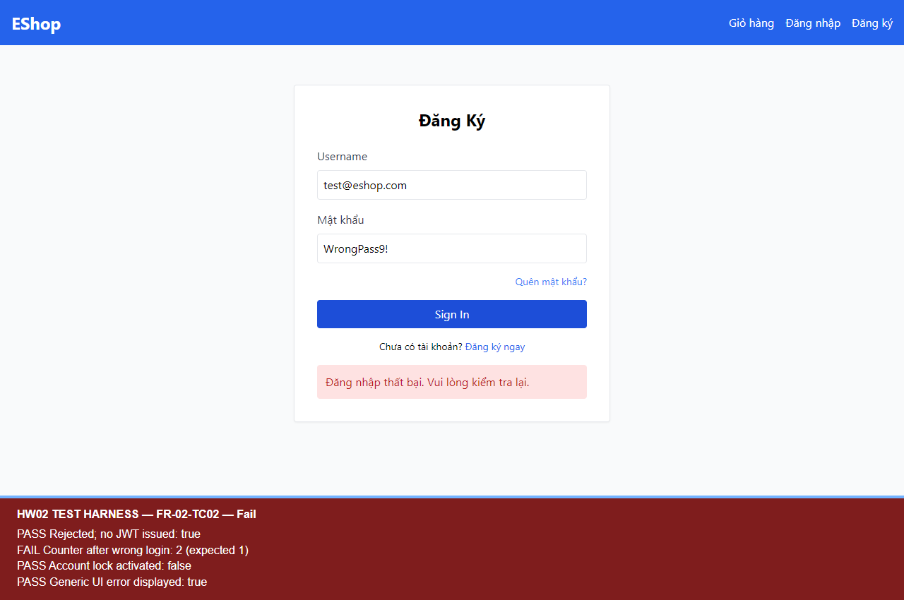
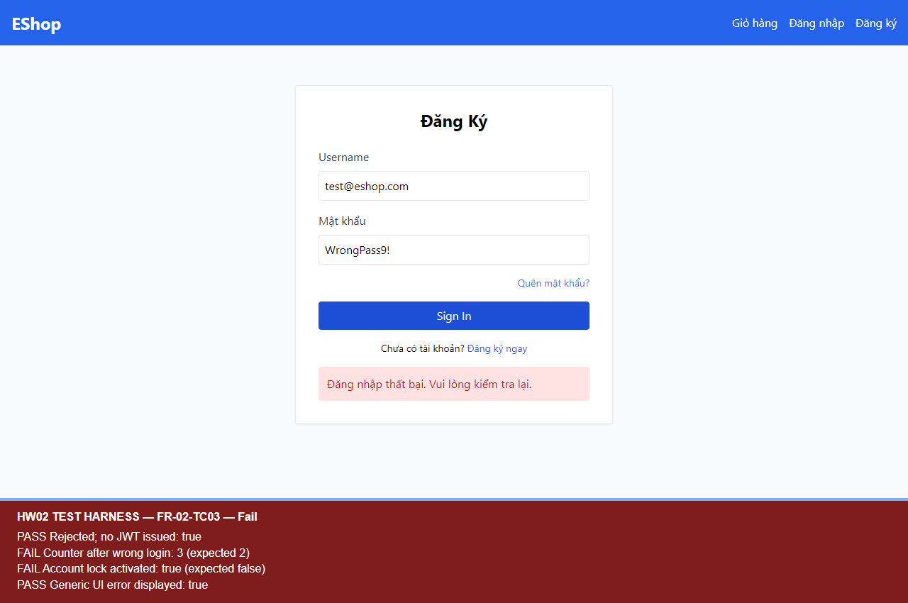

# BUG-FR02-001 — Bộ đếm đăng nhập sai tăng 2 thay vì 1, làm tài khoản khóa sớm

## Yêu cầu

FR-02: sau mỗi lần đăng nhập sai, hệ thống tăng bộ đếm đúng 1; khóa khi sai từ 3 lần liên tiếp.

Nguồn: `eshop-sut/README.md`, mục FR-02 (dòng 38–44).

## Môi trường và tiền điều kiện

- Run-ID: `2026-10-18T05-49-37-116Z-FR-02`.
- TC: FR-02-TC02, FR-02-TC03, FR-02-TC04.
- Node v24.19.0; Windows; Chromium 153.0.8010.12; Playwright 1.62.1; Jest 30.5.2.
- UI http://localhost:5173/login; API http://localhost:3000.
- Source commit: `85af3ba875c88283615e22cb108f13e2fccaf0e9`; hash mã nguồn và trạng thái môi trường trong environment.json của run.
- Mã backend được sao chép nguyên byte; CSDL thử riêng, không sửa DB gốc. Tài khoản/mật khẩu là dữ liệu demo của SUT.

## Bước tái hiện

1. Tài khoản test@eshop.com tồn tại, chưa khóa; đặt login_attempts=0 trong DB thử.
2. Mở /login, nhập tài khoản trên và mật khẩu sai WrongPass9!, bấm Sign In.
3. Đọc login_attempts/locked_until từ CSDL thử sau khi response hoàn tất.
4. Lặp với tiền điều kiện độc lập login_attempts=1 và login_attempts=2 để kiểm tra chuyển trạng thái.

## Expected

Từ n=0 → 1, chưa khóa; n=1 → 2, chưa khóa; n=2 → 3, kích hoạt khóa.

## Actual

TC02: n=0 → 2; TC03: n=1 → 3 và đã khóa; TC04: n=2 → 4. Bộ đếm tăng 2 trên mỗi lần sai, khiến khóa sớm. Các response đều từ chối và không cấp JWT.

## Mức độ và phạm vi quan sát

Medium — người dùng bị khóa sớm hơn ngưỡng nghiệp vụ, ảnh hưởng khả năng đăng nhập.

Đã quan sát ở ba tiền điều kiện độc lập trong cùng run; không diễn giải thành ba bug khác nhau.

## Bằng chứng

- [Assertions, trạng thái CSDL và thời điểm đo](../jest-tests/runs/2026-10-18T05-49-37-116Z-FR-02/results.json).
- [Kết quả Jest](../jest-tests/runs/2026-10-18T05-49-37-116Z-FR-02/jest.json).
- [Video FR-02](../videos/FR-02-demo-paced.webm).

## GitHub Issue

https://github.com/vdt12a11/eshop-sut-testscript/issues/1
