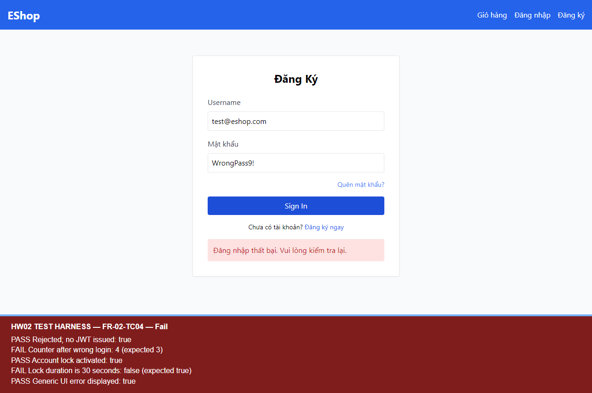
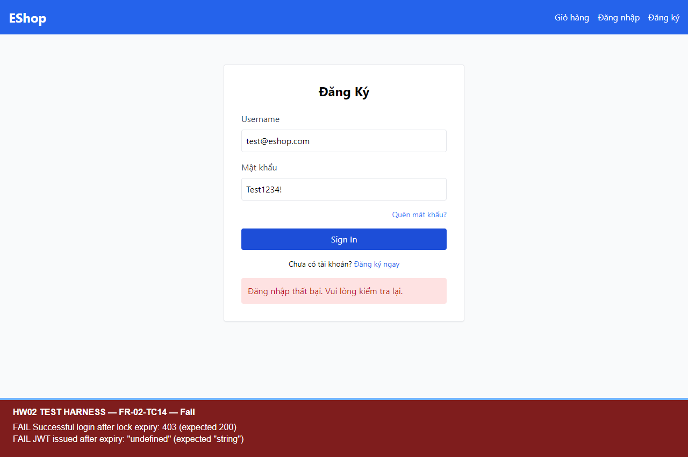

# BUG-FR02-002 — Khóa đăng nhập khoảng 180 giây thay vì 30 giây

## Yêu cầu

FR-02: tài khoản bị tạm khóa 30 giây; thông tin đúng được đăng nhập khi đã hết khóa.

Nguồn: `eshop-sut/README.md`, mục FR-02 (dòng 38–44).

## Môi trường và tiền điều kiện

- Run-ID: `2026-10-18T05-49-37-116Z-FR-02`.
- TC: FR-02-TC04, FR-02-TC14.
- Node v24.19.0; Windows; Chromium 153.0.8010.12; Playwright 1.62.1; Jest 30.5.2.
- UI http://localhost:5173/login; API http://localhost:3000.
- Source commit: `85af3ba875c88283615e22cb108f13e2fccaf0e9`; hash mã nguồn và trạng thái môi trường trong environment.json của run.
- Mã backend được sao chép nguyên byte; CSDL thử riêng, không sửa DB gốc. Tài khoản/mật khẩu là dữ liệu demo của SUT.

## Bước tái hiện

1. Chuẩn bị tài khoản tồn tại, chưa khóa.
2. Gửi mật khẩu sai để kích hoạt một lần khóa mới; ghi thời điểm gửi/nhận và locked_until.
3. Ở TC04, đo khoảng cách từ request kích hoạt đến locked_until.
4. Ở TC14, tạo khóa mới độc lập, chờ ít nhất 31 giây thật rồi gửi mật khẩu đúng Test1234!. Không sửa đồng hồ hoặc locked_until giữa thời gian chờ.

## Expected

Thời hạn khóa 30 giây; sau 31 giây đăng nhập đúng thành công và cấp JWT.

## Actual

TC04: locked_until cách đầu request khoảng 180.048 ms (180,048 giây), trong khi request kéo dài 407 ms. TC14 gửi yêu cầu sau khoảng 31,010–31,863 giây tính từ lần kích hoạt, vẫn nhận HTTP 403 và không được cấp JWT.

## Mức độ và phạm vi quan sát

Medium — kéo dài thời gian khóa khoảng sáu lần, chặn tài khoản hợp lệ sau thời hạn đã quy định.

Đã quan sát thời hạn sai ở TC04 và tiếp tục bị từ chối sau 31 giây ở TC14; cùng một bug thời hạn khóa.

## Bằng chứng

- [Assertions, trạng thái CSDL và thời điểm đo](../jest-tests/runs/2026-10-18T05-49-37-116Z-FR-02/results.json).
- [Kết quả Jest](../jest-tests/runs/2026-10-18T05-49-37-116Z-FR-02/jest.json).
- [Video FR-02](../videos/FR-02-demo-paced.webm).

## GitHub Issue

https://github.com/vdt12a11/eshop-sut-testscript/issues/2
