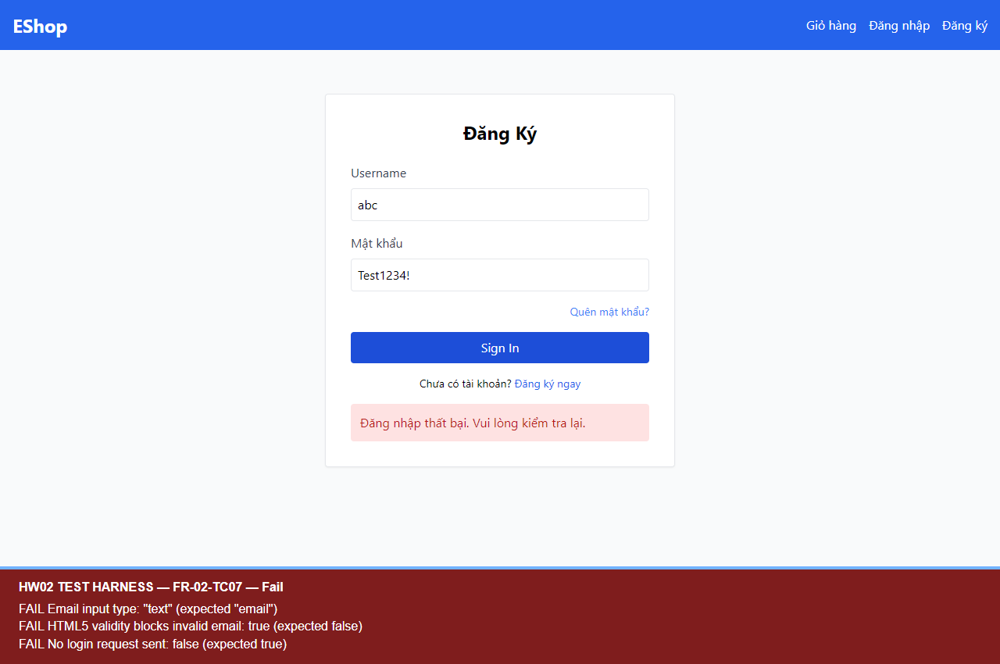

# BUG-FR02-003 — Trường email dùng type=text nên HTML5 không chặn email sai định dạng

## Yêu cầu

FR-02: trường email phải dùng type="email" và có validation HTML5 format.

Nguồn: `eshop-sut/README.md`, mục FR-02 (dòng 38–44).

## Môi trường và tiền điều kiện

- Run-ID: `2026-10-18T05-49-37-116Z-FR-02`.
- TC: FR-02-TC07.
- Node v24.19.0; Windows; Chromium 153.0.8010.12; Playwright 1.62.1; Jest 30.5.2.
- UI http://localhost:5173/login; API http://localhost:3000.
- Source commit: `85af3ba875c88283615e22cb108f13e2fccaf0e9`; hash mã nguồn và trạng thái môi trường trong environment.json của run.
- Mã backend được sao chép nguyên byte; CSDL thử riêng, không sửa DB gốc. Tài khoản/mật khẩu là dữ liệu demo của SUT.

## Bước tái hiện

1. Mở /login trong phiên chưa đăng nhập.
2. Nhập email abc (không rỗng, sai định dạng) và mật khẩu Test1234!.
3. Bấm Sign In, theo dõi POST /api/login và thuộc tính/validity của trường email.

## Expected

Input có type=email; HTML5 đánh dấu abc không hợp lệ và không gửi POST /api/login.

## Actual

Input thực tế có type=text; checkValidity() trả true; một POST /api/login đã được gửi và nhận HTTP 401. Đây là lỗi kiểm tra đầu vào ở UI, không phải đăng nhập trái phép thành công.

## Mức độ và phạm vi quan sát

Medium — bỏ qua ràng buộc kiểm tra định dạng đã được đặc tả và gửi request không hợp lệ tới backend.

Đã quan sát một lần chạy TC07, có screenshot và request log.

## Bằng chứng

- [Assertions, trạng thái CSDL và thời điểm đo](../jest-tests/runs/2026-10-18T05-49-37-116Z-FR-02/results.json).
- [Kết quả Jest](../jest-tests/runs/2026-10-18T05-49-37-116Z-FR-02/jest.json).
- [Video FR-02](../videos/FR-02-demo-paced.webm).

## GitHub Issue

https://github.com/vdt12a11/eshop-sut-testscript/issues/3
