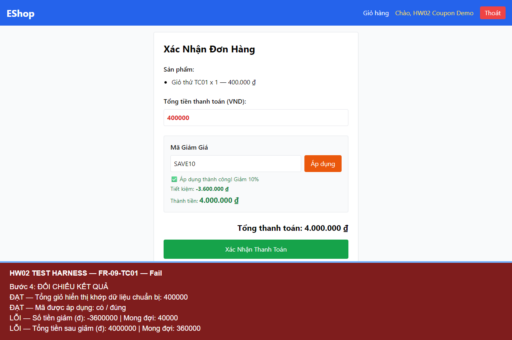

# BUG-FR09-001 — Mã phần trăm tính sai số tiền giảm và tổng thanh toán

## Yêu cầu

Mã loại percent: discount_amount = total × discount_value / 100; final_amount = total − discount_amount.

Nguồn: eshop-sut/README.md, mục FR-09.

## Môi trường

- Run-ID: `2026-10-18T06-19-03-842Z-FR-09`.
- TC: FR-09-TC01.
- Windows, Node v24.19.0, Chromium 153.0.8010.12, Playwright 1.62.1, Jest 30.5.2.
- API http://localhost:3000; giao diện http://localhost:5173/checkout.
- Backend nguyên mã, DB thử riêng; hash DB gốc trước/sau khớp. Source commit và hash mã nguồn nằm trong environment.json của run.

## Bước tái hiện

Chuẩn bị giỏ hàng 400.000 đ từ sản phẩm có giá được lưu trong CSDL; đăng nhập hợp lệ, SAVE10 đang hoạt động, còn hạn, chưa dùng lượt. Mở checkout, nhập SAVE10 rồi bấm Áp dụng.

## Expected

Giảm 40.000 đ (10%); tổng sau giảm 360.000 đ.

## Actual

SAVE10 được chấp nhận nhưng trả discount_amount = -3.600.000 đ, final_amount = 4.000.000 đ. Giao diện hiển thị đúng các giá trị sai này.

### FR-09-TC01

```text
PASS Tổng giỏ hiển thị khớp dữ liệu chuẩn bị: 400000
PASS Mã được áp dụng: true
FAIL Số tiền giảm (đ): -3600000 (expected 40000)
FAIL Tổng tiền sau giảm (đ): 4000000 (expected 360000)
```

## Mức độ và phạm vi quan sát

High — tính sai giá trị thanh toán, khiến số tiền sau giảm tăng mạnh thay vì giảm.

Đã quan sát trong 1 TC của run này; không suy ra tần suất trên các lần chạy chưa thực hiện. Các TC cùng nguyên nhân được tính là một bug.

## Bằng chứng



- [Actual và dữ liệu quan sát](../jest-tests/runs/2026-10-18T06-19-03-842Z-FR-09/results.json).
- [Kết quả Jest](../jest-tests/runs/2026-10-18T06-19-03-842Z-FR-09/jest.json).
- [Môi trường](../jest-tests/runs/2026-10-18T06-19-03-842Z-FR-09/environment.json).
- [Video FR-09](../videos/FR-09-demo.webm).

## GitHub Issue

https://github.com/vdt12a11/eshop-sut-testscript/issues/4
