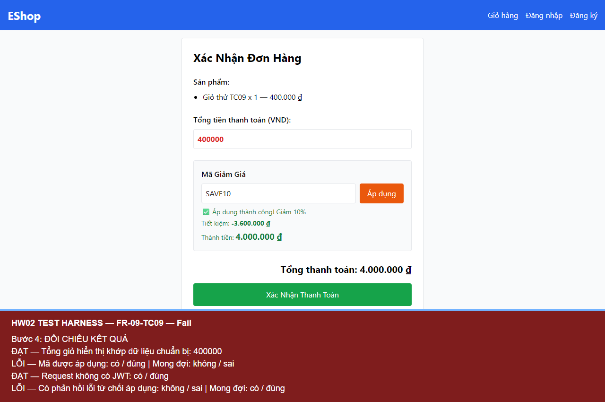

# BUG-FR09-002 — Cho phép áp dụng mã giảm giá khi chưa đăng nhập và không có JWT

## Yêu cầu

C4: người dùng phải có JWT Token hợp lệ để áp dụng mã giảm giá.

Nguồn: eshop-sut/README.md, mục FR-09.

## Môi trường

- Run-ID: `2026-10-18T06-19-03-842Z-FR-09`.
- TC: FR-09-TC09.
- Windows, Node v24.19.0, Chromium 153.0.8010.12, Playwright 1.62.1, Jest 30.5.2.
- API http://localhost:3000; giao diện http://localhost:5173/checkout.
- Backend nguyên mã, DB thử riêng; hash DB gốc trước/sau khớp. Source commit và hash mã nguồn nằm trong environment.json của run.

## Bước tái hiện

Chuẩn bị giỏ hàng hợp lệ 400.000 đ, xóa token khỏi phiên. Truy cập checkout trực tiếp trong router (không dùng nút Tiến hành thanh toán có kiểm tra đăng nhập), nhập SAVE10 và bấm Áp dụng. Kiểm tra header của POST /api/apply-coupon.

## Expected

Không áp dụng giảm giá; phản hồi lỗi do thiếu xác thực.

## Actual

Request không có Authorization/JWT nhưng nhận HTTP 200, success=true và giao diện báo áp dụng mã thành công. Việc điều hướng trực tiếp dùng history/popstate chỉ để mở route kiểm thử; không sửa logic áp dụng mã.

### FR-09-TC09

```text
PASS Tổng giỏ hiển thị khớp dữ liệu chuẩn bị: 400000
FAIL Mã được áp dụng: true (expected false)
PASS Request không có JWT: true
FAIL Có phản hồi lỗi từ chối áp dụng: false (expected true)
```

## Mức độ và phạm vi quan sát

High — bỏ qua điều kiện xác thực của nghiệp vụ áp dụng mã.

Đã quan sát trong 1 TC của run này; không suy ra tần suất trên các lần chạy chưa thực hiện. Các TC cùng nguyên nhân được tính là một bug.

## Bằng chứng



- [Actual và dữ liệu quan sát](../jest-tests/runs/2026-10-18T06-19-03-842Z-FR-09/results.json).
- [Kết quả Jest](../jest-tests/runs/2026-10-18T06-19-03-842Z-FR-09/jest.json).
- [Môi trường](../jest-tests/runs/2026-10-18T06-19-03-842Z-FR-09/environment.json).
- [Video FR-09](../videos/FR-09-demo.webm).

## GitHub Issue

https://github.com/vdt12a11/eshop-sut-testscript/issues/5
