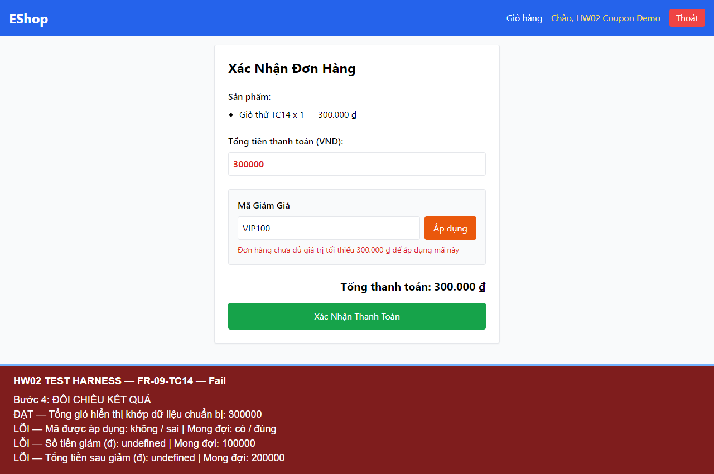

# BUG-FR09-003 — Từ chối mã khi tổng đơn đúng bằng ngưỡng tối thiểu

## Yêu cầu

C3: tổng đơn hàng phải >= min_order_amount, gồm cả giá trị bằng ngưỡng.

Nguồn: eshop-sut/README.md, mục FR-09.

## Môi trường

- Run-ID: `2026-10-18T06-19-03-842Z-FR-09`.
- TC: FR-09-TC14, FR-09-TC17.
- Windows, Node v24.19.0, Chromium 153.0.8010.12, Playwright 1.62.1, Jest 30.5.2.
- API http://localhost:3000; giao diện http://localhost:5173/checkout.
- Backend nguyên mã, DB thử riêng; hash DB gốc trước/sau khớp. Source commit và hash mã nguồn nằm trong environment.json của run.

## Bước tái hiện

Đăng nhập hợp lệ. Lần lượt chuẩn bị giỏ 300.000 đ với VIP100 (đã dùng 1/2 lượt) và giỏ 500.000 đ với BIGBUY (chưa dùng lượt). Các mã đều hoạt động, còn hạn. Ở từng lần độc lập, nhập mã tại checkout và bấm Áp dụng.

## Expected

VIP100 tại 300.000 đ được giảm 100.000 đ, còn 200.000 đ; BIGBUY tại 500.000 đ được giảm 50.000 đ, còn 450.000 đ.

## Actual

Cả hai request đều bị từ chối với HTTP 400 và thông báo chưa đủ giá trị tối thiểu, dù tổng giỏ bằng chính ngưỡng được cấu hình.

### FR-09-TC14

```text
PASS Tổng giỏ hiển thị khớp dữ liệu chuẩn bị: 300000
FAIL Mã được áp dụng: false (expected true)
FAIL Số tiền giảm (đ): undefined (expected 100000)
FAIL Tổng tiền sau giảm (đ): undefined (expected 200000)
```

### FR-09-TC17

```text
PASS Tổng giỏ hiển thị khớp dữ liệu chuẩn bị: 500000
FAIL Mã được áp dụng: false (expected true)
FAIL Số tiền giảm (đ): undefined (expected 50000)
FAIL Tổng tiền sau giảm (đ): undefined (expected 450000)
```

## Mức độ và phạm vi quan sát

Medium — người dùng đạt ngưỡng hợp lệ vẫn không được hưởng mã giảm giá.

Đã quan sát trong 2 TC của run này; không suy ra tần suất trên các lần chạy chưa thực hiện. Các TC cùng nguyên nhân được tính là một bug.

## Bằng chứng




- [Actual và dữ liệu quan sát](../jest-tests/runs/2026-10-18T06-19-03-842Z-FR-09/results.json).
- [Kết quả Jest](../jest-tests/runs/2026-10-18T06-19-03-842Z-FR-09/jest.json).
- [Môi trường](../jest-tests/runs/2026-10-18T06-19-03-842Z-FR-09/environment.json).
- [Video FR-09](../videos/FR-09-demo.webm).

## GitHub Issue

https://github.com/vdt12a11/eshop-sut-testscript/issues/6
