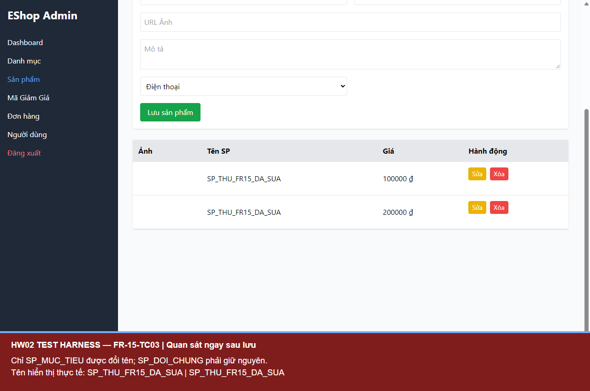
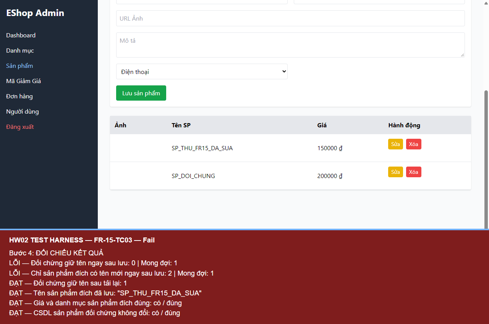

# BUG-FR15-001 — Danh sách sản phẩm cập nhật sai ngay sau khi sửa: đổi tên cả sản phẩm khác và giữ giá cũ

## Yêu cầu

Khi sửa, chỉ sản phẩm đích thay đổi; các sản phẩm khác giữ nguyên, ngay sau lưu và sau tải lại.

Nguồn: eshop-sut/README.md, mục FR-15.

## Môi trường

- Run-ID: `2026-10-18T06-27-29-324Z-FR-15`.
- TC: FR-15-TC03.
- Windows, Node v24.19.0, Chromium 153.0.8010.12, Playwright 1.62.1, Jest 30.5.2.
- API http://localhost:3000; giao diện http://localhost:5174.
- Backend nguyên mã, DB thử riêng; hash DB gốc trước/sau khớp. Source commit và hash mã nguồn nằm trong environment.json của run.

## Bước tái hiện

Admin đăng nhập; chuẩn bị SP_MUC_TIEU và SP_DOI_CHUNG. Sửa SP_MUC_TIEU thành SP_THU_FR15_DA_SUA, giá 150.000 đ, danh mục Laptop. Bấm Lưu sản phẩm. Quan sát danh sách ngay sau thông báo lưu thành công, rồi tải lại và đối chiếu lần nữa.

## Expected

Chỉ sản phẩm đích đổi tên, giá, danh mục; SP_DOI_CHUNG giữ nguyên ở cả hai thời điểm.

## Actual

Ngay sau lưu, cả hai dòng trong danh sách đều mang tên SP_THU_FR15_DA_SUA; tên SP_DOI_CHUNG biến mất. Ảnh ngay sau lưu còn cho thấy dòng sản phẩm đích giữ giá cũ 100.000 đ, trong khi dữ liệu đã lưu là 150.000 đ. Sau tải lại, danh sách hiển thị đúng trở lại. CSDL của sản phẩm đối chứng không bị sửa; các sai lệch thuộc cùng bước cập nhật trạng thái danh sách trên giao diện. Kiểm tra tên có assertion tự động; giá cũ ở UI được ghi nhận từ ảnh chụp.

### FR-15-TC03

```text
FAIL Đối chứng giữ tên ngay sau lưu: 0 (expected 1)
FAIL Chỉ sản phẩm đích có tên mới ngay sau lưu: 2 (expected 1)
PASS Đối chứng giữ tên sau tải lại: 1
PASS Tên sản phẩm đích đã lưu: "SP_THU_FR15_DA_SUA"
PASS Giá và danh mục sản phẩm đích đúng: true
PASS CSDL sản phẩm đối chứng không đổi: true
```

## Mức độ và phạm vi quan sát

Medium — hiển thị sai danh tính sản phẩm khác sau thao tác sửa, có thể khiến quản trị viên thao tác nhầm.

Đã quan sát trong 1 TC của run này; không suy ra tần suất trên các lần chạy chưa thực hiện. Các TC cùng nguyên nhân được tính là một bug.

## Bằng chứng





- [Actual và dữ liệu quan sát](../jest-tests/runs/2026-10-18T06-27-29-324Z-FR-15/results.json).
- [Kết quả Jest](../jest-tests/runs/2026-10-18T06-27-29-324Z-FR-15/jest.json).
- [Môi trường](../jest-tests/runs/2026-10-18T06-27-29-324Z-FR-15/environment.json).
- [Video FR-15](../videos/FR-15-demo.webm).

## GitHub Issue

https://github.com/vdt12a11/eshop-sut-testscript/issues/7
