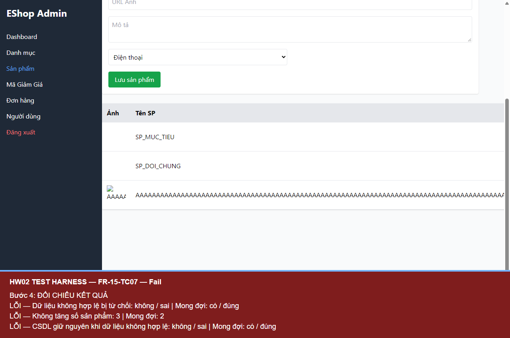

# BUG-FR15-002 — Chấp nhận và lưu tên sản phẩm dài 256 ký tự

## Yêu cầu

Tên sản phẩm bắt buộc và tối đa 255 ký tự.

Nguồn: eshop-sut/README.md, mục FR-15.

## Môi trường

- Run-ID: `2026-10-18T06-27-29-324Z-FR-15`.
- TC: FR-15-TC07.
- Windows, Node v24.19.0, Chromium 153.0.8010.12, Playwright 1.62.1, Jest 30.5.2.
- API http://localhost:3000; giao diện http://localhost:5174.
- Backend nguyên mã, DB thử riêng; hash DB gốc trước/sau khớp. Source commit và hash mã nguồn nằm trong environment.json của run.

## Bước tái hiện

Admin đăng nhập. Nhập tên là 256 ký tự ASCII A, giá 100.000 đ và chọn danh mục Điện thoại có sẵn. Bấm Lưu sản phẩm; kiểm tra response và danh sách/CSDL.

## Expected

Từ chối tên quá dài; không tạo sản phẩm mới, số sản phẩm không tăng.

## Actual

HTTP 200, sản phẩm mới có tên 256 ký tự được tạo và hiển thị; số sản phẩm tăng từ 2 lên 3.

### FR-15-TC07

```text
FAIL Dữ liệu không hợp lệ bị từ chối: false (expected true)
FAIL Không tăng số sản phẩm: 3 (expected 2)
FAIL CSDL giữ nguyên khi dữ liệu không hợp lệ: false (expected true)
```

## Mức độ và phạm vi quan sát

Medium — dữ liệu vượt giới hạn nghiệp vụ được lưu vào danh mục sản phẩm.

Đã quan sát trong 1 TC của run này; không suy ra tần suất trên các lần chạy chưa thực hiện. Các TC cùng nguyên nhân được tính là một bug.

## Bằng chứng



- [Actual và dữ liệu quan sát](../jest-tests/runs/2026-10-18T06-27-29-324Z-FR-15/results.json).
- [Kết quả Jest](../jest-tests/runs/2026-10-18T06-27-29-324Z-FR-15/jest.json).
- [Môi trường](../jest-tests/runs/2026-10-18T06-27-29-324Z-FR-15/environment.json).
- [Video FR-15](../videos/FR-15-demo.webm).

## GitHub Issue

https://github.com/vdt12a11/eshop-sut-testscript/issues/8
