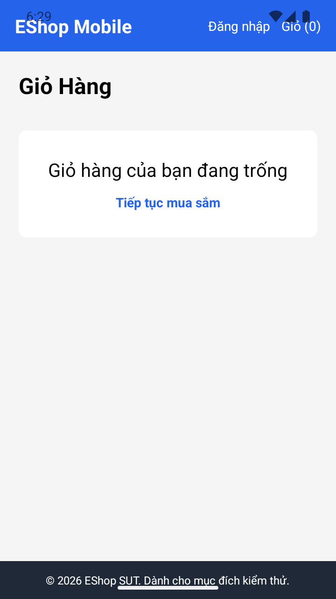

# BUG-FR20-001 — Giỏ hàng Mobile trống thiếu hình minh họa

## Yêu cầu và nguồn

FR-20 tham chiếu FR-07: giỏ hàng trống phải có hình minh họa và thông báo rõ ràng; FR-24: Empty State có icon/hình minh họa và message.

Nguồn: `eshop-sut/README.md`, FR-20/FR-07/FR-24; báo cáo thiết kế mục 5. Các quy tắc giỏ hàng Mobile được ghi rõ là tham chiếu nghiệp vụ vì FR-20 chưa mô tả riêng.

## Môi trường và dữ liệu

- Android 16 / API 36, Expo Go 54.0.8, React Native 0.81.5; UiAutomator2 10.7.0, ADB, Jest.
- SUT commit: `85af3ba875c88283615e22cb108f13e2fccaf0e9`; source và CSDL gốc không thay đổi. Backend fixture riêng; không sửa logic Mobile.
- SP_A: 100.000 đ; SP_B: 50.000 đ. Giỏ thiết lập bằng thao tác UI riêng cho mỗi TC.
- Severity: Low — giao diện trạng thái trống chưa đáp ứng đặc tả.

## Bước tái hiện

Mở ứng dụng Mobile với giỏ trống, hoặc xóa sản phẩm cuối cùng rồi xem giỏ.

## Expected

Có hình minh họa/icon cùng thông báo giỏ trống rõ ràng.

## Actual

Chỉ có thông báo và liên kết mua sắm, không có hình minh họa trong khu vực giỏ trống.

### FR-20-TC01 — 2026-10-18T11-50-17-624Z-FR-20

```json
{
  "checks": [
    {
      "label": "Có hình minh họa trong giỏ trống",
      "actual": false,
      "expected": true,
      "pass": false
    }
  ],
  "observations": {
    "before": {
      "lines": [
        "6:50",
        "Wifi signal full.",
        "T-Mobile, no signal.",
        "Battery 100 percent.",
        "EShop Mobile",
        "EShop Mobile",
        "Đăng nhập",
        "Đăng nhập",
        "Giỏ (0)",
        "Giỏ (0)",
        "Giỏ Hàng",
        "Giỏ hàng của bạn đang trống",
        "Tiếp tục mua sắm",
        "Tiếp tục mua sắm",
        "© 2026 EShop SUT. Dành cho mục đích kiểm thử."
      ],
      "rows": {},
      "quantities": [],
      "products": [],
      "totals": [],
      "amounts": [],
      "plus_count": 0,
      "minus_count": 0
    },
    "image_nodes": []
  }
}
```

[Hồ sơ chạy](../jest-tests/runs/2026-10-18T11-50-17-624Z-FR-20/results.json)

### FR-20-TC08 — 2026-10-18T11-28-19-844Z-FR-20

```json
{
  "checks": [
    {
      "label": "Có hình minh họa giỏ trống",
      "actual": false,
      "expected": true,
      "pass": false
    }
  ],
  "observations": {
    "before": {
      "lines": [
        "EShop Mobile",
        "EShop Mobile",
        "Đăng nhập",
        "Đăng nhập",
        "Giỏ (1)",
        "Giỏ (1)",
        "Giỏ Hàng",
        "SP_A",
        "Giá: 100,000 ₫",
        "Số lượng:",
        "1",
        "Xóa",
        "Xóa",
        "Thành tiền: 100,000 ₫",
        "Tổng tạm tính: 100,000 ₫",
        "← Mua tiếp",
        "← Mua tiếp",
        "Tiến hành thanh toán",
        "Tiến hành thanh toán",
        "© 2026 EShop SUT. Dành cho mục đích kiểm thử."
      ],
      "rows": {
        "SP_A": {
          "quantity": "1",
          "amount": 100000
        }
      },
      "quantities": [
        "1"
      ],
      "products": [
        "SP_A"
      ],
      "totals": [
        "Tổng tạm tính: 100,000 ₫"
      ],
      "amounts": [
        "Thành tiền: 100,000 ₫"
      ],
      "plus_count": 0,
      "minus_count": 0
    },
    "confirmation_present": false,
    "after": {
      "lines": [
        "EShop Mobile",
        "EShop Mobile",
        "Đăng nhập",
        "Đăng nhập",
        "Giỏ (0)",
        "Giỏ (0)",
        "Giỏ Hàng",
        "Giỏ hàng của bạn đang trống",
        "Tiếp tục mua sắm",
        "Tiếp tục mua sắm",
        "© 2026 EShop SUT. Dành cho mục đích kiểm thử."
      ],
      "rows": {},
      "quantities": [],
      "products": [],
      "totals": [],
      "amounts": [],
      "plus_count": 0,
      "minus_count": 0
    }
  }
}
```

[Hồ sơ chạy](../jest-tests/runs/2026-10-18T11-28-19-844Z-FR-20/results.json)

## Bằng chứng




Ảnh lấy trực tiếp từ Android bằng ADB, không phải ảnh frontend Web. Hiện tượng được ghi ở các TC/run nêu trên; không suy ra số lần tái hiện ngoài bằng chứng đã có.

## GitHub Issue

https://github.com/vdt12a11/eshop-sut-testscript/issues/10
