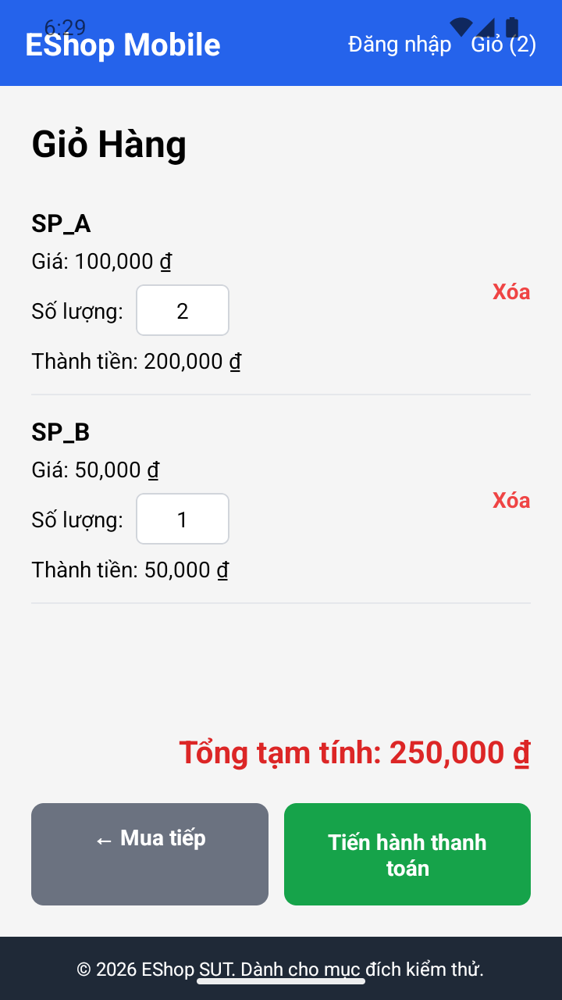
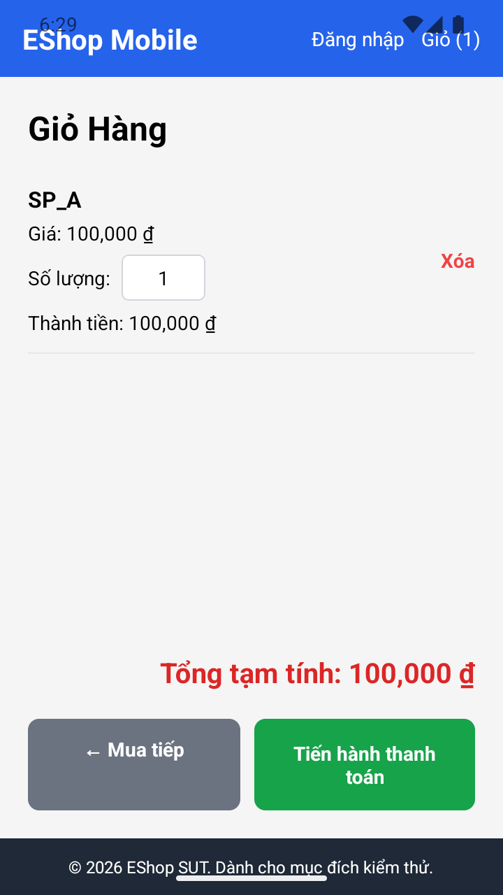

# BUG-FR20-004 — Xóa sản phẩm khỏi giỏ Mobile ngay lập tức, không có xác nhận

## Yêu cầu và nguồn

FR-20 tham chiếu FR-07 và FR-24: phải có dialog xác nhận trước khi xóa sản phẩm.

Nguồn: `eshop-sut/README.md`, FR-20/FR-07/FR-24; báo cáo thiết kế mục 5. Các quy tắc giỏ hàng Mobile được ghi rõ là tham chiếu nghiệp vụ vì FR-20 chưa mô tả riêng.

## Môi trường và dữ liệu

- Android 16 / API 36, Expo Go 54.0.8, React Native 0.81.5; UiAutomator2 10.7.0, ADB, Jest.
- SUT commit: `85af3ba875c88283615e22cb108f13e2fccaf0e9`; source và CSDL gốc không thay đổi. Backend fixture riêng; không sửa logic Mobile.
- SP_A: 100.000 đ; SP_B: 50.000 đ. Giỏ thiết lập bằng thao tác UI riêng cho mỗi TC.
- Severity: Medium — có thể xóa nhầm, người dùng không có cơ hội hủy.

## Bước tái hiện

Chuẩn bị SP_A số lượng 2 và SP_B số lượng 1; mở Giỏ hàng; bấm Xóa ở SP_A; quan sát trước khi đồng ý/hủy.

## Expected

Hộp thoại xác nhận xuất hiện; giỏ giữ nguyên khi chưa chọn hoặc khi hủy; chỉ xóa sau đồng ý.

## Actual

SP_A biến mất ngay sau bấm Xóa, không có hộp thoại. Không thể thực hiện nhánh Hủy như thiết kế TC06.

### FR-20-TC06 — 2026-10-18T11-50-17-624Z-FR-20

```json
{
  "checks": [
    {
      "label": "Hiện hộp thoại xác nhận xóa",
      "actual": false,
      "expected": true,
      "pass": false
    }
  ],
  "observations": {
    "before": {
      "lines": [
        "6:51",
        "Wifi signal full.",
        "T-Mobile, three bars.",
        "Battery 100 percent.",
        "EShop Mobile",
        "EShop Mobile",
        "Đăng nhập",
        "Đăng nhập",
        "Giỏ (2)",
        "Giỏ (2)",
        "Giỏ Hàng",
        "SP_A",
        "Giá: 100,000 ₫",
        "Số lượng:",
        "2",
        "Xóa",
        "Xóa",
        "Thành tiền: 200,000 ₫",
        "SP_B",
        "Giá: 50,000 ₫",
        "Số lượng:",
        "1",
        "Xóa",
        "Xóa",
        "Thành tiền: 50,000 ₫",
        "Tổng tạm tính: 250,000 ₫",
        "← Mua tiếp",
        "← Mua tiếp",
        "Tiến hành thanh toán",
        "Tiến hành thanh toán",
        "© 2026 EShop SUT. Dành cho mục đích kiểm thử."
      ],
      "rows": {
        "SP_A": {
          "quantity": "2",
          "amount": 200000
        },
        "SP_B": {
          "quantity": "1",
          "amount": 50000
        }
      },
      "quantities": [
        "2",
        "1"
      ],
      "products": [
        "SP_A",
        "SP_B"
      ],
      "totals": [
        "Tổng tạm tính: 250,000 ₫"
      ],
      "amounts": [
        "Thành tiền: 200,000 ₫",
        "Thành tiền: 50,000 ₫"
      ],
      "plus_count": 0,
      "minus_count": 0
    },
    "confirmation_present": false,
    "after": {
      "lines": [
        "6:52",
        "Wifi signal full.",
        "T-Mobile, three bars.",
        "Battery 100 percent.",
        "EShop Mobile",
        "EShop Mobile",
        "Đăng nhập",
        "Đăng nhập",
        "Giỏ (1)",
        "Giỏ (1)",
        "Giỏ Hàng",
        "SP_B",
        "Giá: 50,000 ₫",
        "Số lượng:",
        "1",
        "Xóa",
        "Xóa",
        "Thành tiền: 50,000 ₫",
        "Tổng tạm tính: 50,000 ₫",
        "← Mua tiếp",
        "← Mua tiếp",
        "Tiến hành thanh toán",
        "Tiến hành thanh toán",
        "© 2026 EShop SUT. Dành cho mục đích kiểm thử."
      ],
      "rows": {
        "SP_B": {
          "quantity": "1",
          "amount": 50000
        }
      },
      "quantities": [
        "1"
      ],
      "products": [
        "SP_B"
      ],
      "totals": [
        "Tổng tạm tính: 50,000 ₫"
      ],
      "amounts": [
        "Thành tiền: 50,000 ₫"
      ],
      "plus_count": 0,
      "minus_count": 0
    }
  }
}
```

[Hồ sơ chạy](../jest-tests/runs/2026-10-18T11-50-17-624Z-FR-20/results.json)

### FR-20-TC07 — 2026-10-18T11-28-19-844Z-FR-20

```json
{
  "checks": [
    {
      "label": "Hiện hộp thoại xác nhận xóa",
      "actual": false,
      "expected": true,
      "pass": false
    }
  ],
  "observations": {
    "before": {
      "lines": [
        "EShop Mobile",
        "EShop Mobile",
        "Đăng nhập",
        "Đăng nhập",
        "Giỏ (2)",
        "Giỏ (2)",
        "Giỏ Hàng",
        "SP_A",
        "Giá: 100,000 ₫",
        "Số lượng:",
        "2",
        "Xóa",
        "Xóa",
        "Thành tiền: 200,000 ₫",
        "SP_B",
        "Giá: 50,000 ₫",
        "Số lượng:",
        "1",
        "Xóa",
        "Xóa",
        "Thành tiền: 50,000 ₫",
        "Tổng tạm tính: 250,000 ₫",
        "← Mua tiếp",
        "← Mua tiếp",
        "Tiến hành thanh toán",
        "Tiến hành thanh toán",
        "© 2026 EShop SUT. Dành cho mục đích kiểm thử."
      ],
      "rows": {
        "SP_A": {
          "quantity": "2",
          "amount": 200000
        },
        "SP_B": {
          "quantity": "1",
          "amount": 50000
        }
      },
      "quantities": [
        "2",
        "1"
      ],
      "products": [
        "SP_A",
        "SP_B"
      ],
      "totals": [
        "Tổng tạm tính: 250,000 ₫"
      ],
      "amounts": [
        "Thành tiền: 200,000 ₫",
        "Thành tiền: 50,000 ₫"
      ],
      "plus_count": 0,
      "minus_count": 0
    },
    "confirmation_present": false,
    "after": {
      "lines": [
        "EShop Mobile",
        "EShop Mobile",
        "Đăng nhập",
        "Đăng nhập",
        "Giỏ (1)",
        "Giỏ (1)",
        "Giỏ Hàng",
        "SP_B",
        "Giá: 50,000 ₫",
        "Số lượng:",
        "1",
        "Xóa",
        "Xóa",
        "Thành tiền: 50,000 ₫",
        "Tổng tạm tính: 50,000 ₫",
        "← Mua tiếp",
        "← Mua tiếp",
        "Tiến hành thanh toán",
        "Tiến hành thanh toán",
        "© 2026 EShop SUT. Dành cho mục đích kiểm thử."
      ],
      "rows": {
        "SP_B": {
          "quantity": "1",
          "amount": 50000
        }
      },
      "quantities": [
        "1"
      ],
      "products": [
        "SP_B"
      ],
      "totals": [
        "Tổng tạm tính: 50,000 ₫"
      ],
      "amounts": [
        "Thành tiền: 50,000 ₫"
      ],
      "plus_count": 0,
      "minus_count": 0
    }
  }
}
```

[Hồ sơ chạy](../jest-tests/runs/2026-10-18T11-28-19-844Z-FR-20/results.json)

### FR-20-TC08 — 2026-10-18T11-28-19-844Z-FR-20

```json
{
  "checks": [
    {
      "label": "Hiện hộp thoại xác nhận xóa",
      "actual": false,
      "expected": true,
      "pass": false
    }
  ],
  "observations": {
    "before": {
      "lines": [
        "EShop Mobile",
        "EShop Mobile",
        "Đăng nhập",
        "Đăng nhập",
        "Giỏ (1)",
        "Giỏ (1)",
        "Giỏ Hàng",
        "SP_A",
        "Giá: 100,000 ₫",
        "Số lượng:",
        "1",
        "Xóa",
        "Xóa",
        "Thành tiền: 100,000 ₫",
        "Tổng tạm tính: 100,000 ₫",
        "← Mua tiếp",
        "← Mua tiếp",
        "Tiến hành thanh toán",
        "Tiến hành thanh toán",
        "© 2026 EShop SUT. Dành cho mục đích kiểm thử."
      ],
      "rows": {
        "SP_A": {
          "quantity": "1",
          "amount": 100000
        }
      },
      "quantities": [
        "1"
      ],
      "products": [
        "SP_A"
      ],
      "totals": [
        "Tổng tạm tính: 100,000 ₫"
      ],
      "amounts": [
        "Thành tiền: 100,000 ₫"
      ],
      "plus_count": 0,
      "minus_count": 0
    },
    "confirmation_present": false,
    "after": {
      "lines": [
        "EShop Mobile",
        "EShop Mobile",
        "Đăng nhập",
        "Đăng nhập",
        "Giỏ (0)",
        "Giỏ (0)",
        "Giỏ Hàng",
        "Giỏ hàng của bạn đang trống",
        "Tiếp tục mua sắm",
        "Tiếp tục mua sắm",
        "© 2026 EShop SUT. Dành cho mục đích kiểm thử."
      ],
      "rows": {},
      "quantities": [],
      "products": [],
      "totals": [],
      "amounts": [],
      "plus_count": 0,
      "minus_count": 0
    }
  }
}
```

[Hồ sơ chạy](../jest-tests/runs/2026-10-18T11-28-19-844Z-FR-20/results.json)

## Bằng chứng








Ảnh lấy trực tiếp từ Android bằng ADB, không phải ảnh frontend Web. Hiện tượng được ghi ở các TC/run nêu trên; không suy ra số lần tái hiện ngoài bằng chứng đã có.

## GitHub Issue

https://github.com/vdt12a11/eshop-sut-testscript/issues/13
