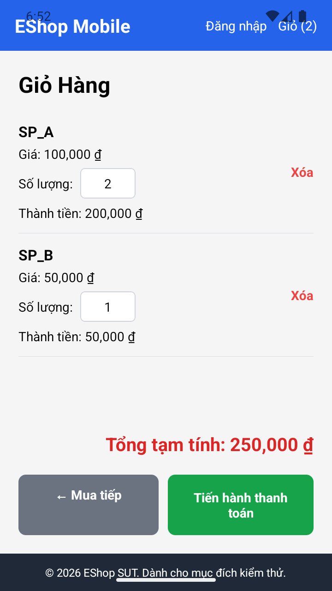
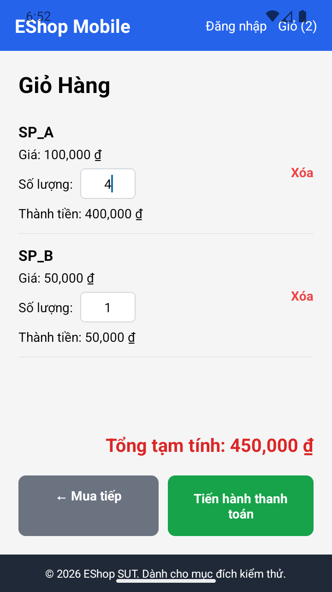

# BUG-FR20-005 — Nhập tay số lượng 3 trong giỏ Mobile cho kết quả sai

## Yêu cầu và nguồn

FR-20 Giỏ hàng Mobile, TC14 do sinh viên bổ sung: nhập tay 3 phải cập nhật đúng số lượng; thành tiền = đơn giá × số lượng, sản phẩm khác giữ nguyên.

Nguồn: `eshop-sut/README.md`, FR-20/FR-07/FR-24; báo cáo thiết kế mục 5. Các quy tắc giỏ hàng Mobile được ghi rõ là tham chiếu nghiệp vụ vì FR-20 chưa mô tả riêng.

## Môi trường và dữ liệu

- Android 16 / API 36, Expo Go 54.0.8, React Native 0.81.5; UiAutomator2 10.7.0, ADB, Jest.
- SUT commit: `85af3ba875c88283615e22cb108f13e2fccaf0e9`; source và CSDL gốc không thay đổi. Backend fixture riêng; không sửa logic Mobile.
- SP_A: 100.000 đ; SP_B: 50.000 đ. Giỏ thiết lập bằng thao tác UI riêng cho mỗi TC.
- Severity: Medium — số lượng, thành tiền và tổng tiền khác dữ liệu người dùng nhập.

## Bước tái hiện

Chuẩn bị SP_A giá 100.000 đ, số lượng 2 và SP_B giá 50.000 đ, số lượng 1; chọn toàn bộ nội dung ô số lượng SP_A, nhập 3 rồi kết thúc chỉnh sửa.

## Expected

SP_A số lượng 3, thành tiền 300.000 đ; SP_B số lượng 1, thành tiền 50.000 đ; tổng 350.000 đ.

## Actual

Số lượng SP_A sau nhập không bằng 3; thành tiền và tổng tiền tương ứng cũng không khớp expected. Giá trị quan sát cụ thể được ghi dưới đây từ run native.

### FR-20-TC14 — 2026-10-18T11-50-17-624Z-FR-20

```json
{
  "checks": [
    {
      "label": "SP_A số lượng",
      "actual": "4",
      "expected": "3",
      "pass": false
    }
  ],
  "observations": {
    "before": {
      "lines": [
        "6:52",
        "Wifi signal full.",
        "T-Mobile, two bars.",
        "Battery 100 percent.",
        "EShop Mobile",
        "EShop Mobile",
        "Đăng nhập",
        "Đăng nhập",
        "Giỏ (2)",
        "Giỏ (2)",
        "Giỏ Hàng",
        "SP_A",
        "Giá: 100,000 ₫",
        "Số lượng:",
        "2",
        "Xóa",
        "Xóa",
        "Thành tiền: 200,000 ₫",
        "SP_B",
        "Giá: 50,000 ₫",
        "Số lượng:",
        "1",
        "Xóa",
        "Xóa",
        "Thành tiền: 50,000 ₫",
        "Tổng tạm tính: 250,000 ₫",
        "← Mua tiếp",
        "← Mua tiếp",
        "Tiến hành thanh toán",
        "Tiến hành thanh toán",
        "© 2026 EShop SUT. Dành cho mục đích kiểm thử."
      ],
      "rows": {
        "SP_A": {
          "quantity": "2",
          "amount": 200000
        },
        "SP_B": {
          "quantity": "1",
          "amount": 50000
        }
      },
      "quantities": [
        "2",
        "1"
      ],
      "products": [
        "SP_A",
        "SP_B"
      ],
      "totals": [
        "Tổng tạm tính: 250,000 ₫"
      ],
      "amounts": [
        "Thành tiền: 200,000 ₫",
        "Thành tiền: 50,000 ₫"
      ],
      "plus_count": 0,
      "minus_count": 0
    },
    "attempted_input": "3",
    "entered_input": "4",
    "after": {
      "lines": [
        "6:52",
        "Wifi signal full.",
        "T-Mobile, one bar.",
        "Battery 100 percent.",
        "EShop Mobile",
        "EShop Mobile",
        "Đăng nhập",
        "Đăng nhập",
        "Giỏ (2)",
        "Giỏ (2)",
        "Giỏ Hàng",
        "SP_A",
        "Giá: 100,000 ₫",
        "Số lượng:",
        "4",
        "Xóa",
        "Xóa",
        "Thành tiền: 400,000 ₫",
        "SP_B",
        "Giá: 50,000 ₫",
        "Số lượng:",
        "1",
        "Xóa",
        "Xóa",
        "Thành tiền: 50,000 ₫",
        "Tổng tạm tính: 450,000 ₫",
        "← Mua tiếp",
        "← Mua tiếp",
        "Tiến hành thanh toán",
        "Tiến hành thanh toán",
        "© 2026 EShop SUT. Dành cho mục đích kiểm thử."
      ],
      "rows": {
        "SP_A": {
          "quantity": "4",
          "amount": 400000
        },
        "SP_B": {
          "quantity": "1",
          "amount": 50000
        }
      },
      "quantities": [
        "4",
        "1"
      ],
      "products": [
        "SP_A",
        "SP_B"
      ],
      "totals": [
        "Tổng tạm tính: 450,000 ₫"
      ],
      "amounts": [
        "Thành tiền: 400,000 ₫",
        "Thành tiền: 50,000 ₫"
      ],
      "plus_count": 0,
      "minus_count": 0
    }
  }
}
```

[Hồ sơ chạy](../jest-tests/runs/2026-10-18T11-50-17-624Z-FR-20/results.json)

## Bằng chứng




Ảnh lấy trực tiếp từ Android bằng ADB, không phải ảnh frontend Web. Hiện tượng được ghi ở các TC/run nêu trên; không suy ra số lần tái hiện ngoài bằng chứng đã có.

## GitHub Issue

https://github.com/vdt12a11/eshop-sut-testscript/issues/14
